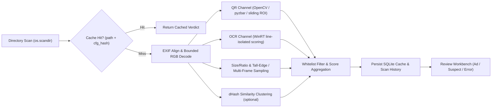

<div align="center">


# Ad Image Filter GUI · 广告图过滤

**Fully offline Windows workbench for detecting, reviewing, and safely isolating promotional and QR-code clutter in local image folders**

[](https://github.com/ElmaTony/Ad-Image-Filter-GUI/releases/latest)
[](https://github.com/ElmaTony/Ad-Image-Filter-GUI/releases)
[](requirements.txt)
[](https://github.com/ElmaTony/Ad-Image-Filter-GUI)

[简体中文](README.md) · **English**

[Key Highlights](#key-highlights) · [Detection Pipeline](#detection-pipeline) · [Quick Start](#quick-start) · [Workbench and Shortcuts](#workbench-and-shortcuts) · [Privacy and Portable Data](#privacy-and-portable-data) · [Development and Build](#development-and-build)

<br>

<picture>
  <source media="(prefers-color-scheme: dark)" srcset="docs/screenshots/workbench-dark.png">
  <source media="(prefers-color-scheme: light)" srcset="docs/screenshots/workbench-light.png">
  
</picture>

</div>

---

Image archives and download batches often contain unwanted QR-code promos, social-channel banners, header/footer watermarks, and tiny decorative icons. **Ad Image Filter GUI** pairs a **local multi-channel detection engine** with a **two-pane review workbench**: all analysis runs offline on your PC, every flagged image shows transparent rule scores and evidence, and you review items before moving them to a reversible quarantine folder.

## Key Highlights

- **100% Offline Multi-Channel Detection**: Combines QR decoding, Windows native WinRT OCR, tall-image edge strip sampling, animated GIF/WebP frame sampling, dimension/aspect-ratio heuristics, and optional dHash similarity clustering—no cloud APIs or GPU required.
- **Explainable Evidence & Review-First Workflow**: Inspect exact triggered rules, composite score, decoded QR/URL details, and OCR excerpts right in the detail pane, or filter by verdict (`Ad` / `Suspect` / `Error`) and specific reason.
- **Safe & Reversible Actions**: Defaults to **Quarantine** instead of permanent deletion—cross-drive moves target `_广告隔离` on the drive root with a JSON manifest, write-ahead journal (`ad_filter_log.jsonl`), directory locking, one-click undo, and a dedicated Quarantine manager for selective restore.
- **High-Throughput Scanning & Smart Caching**: Uses `os.scandir` directory traversal, bounded low-memory RGB decoding with EXIF orientation alignment, and a SQLite cache keyed by `(path, cfg_hash)` that automatically invalidates on rule changes and prunes stale entries.
- **Modern Fluent Workbench**: Built with PySide6 and QFluentWidgets featuring light/dark themes, 4 curated palettes (`atelier`, `slate`, `sage`, `obsidian`), 3 card density modes (`compact`, `standard`, `large`), a `Ctrl+K` command palette, and a zoomable Lightbox viewer.

## Detection Pipeline

For every discovered image, `ad_filter.py` evaluates rule channels in parallel, applies whitelist suppression, and produces a verdict (`ad`, `suspect`, `clean`, or `error`):



| Channel | What It Catches | Key Behavior |
| --- | --- | --- |
| **QR Recognition** | Promotional QR codes, referral links, and mini-program codes | Combines OpenCV, pyzbar, and multi-scale sliding-window ROIs; extracts both URL/naked-domain links and text QR details |
| **Local OCR** | Chinese, English, and Japanese promo text and call-to-action banners | Powered by Windows WinRT OCR; evaluates keywords and regex weights per line to prevent cross-line false positives; samples head/tail edge strips on tall vertical images |
| **Animated & Size Rules** | Hidden promo frames in GIF/WebP files and extreme banner/icon sizes | Samples multiple frames across animated images; scores tiny icons, extreme banner aspect ratios, and stitched long posters |
| **dHash Clustering (Optional)** | Duplicate promotional flyers distributed across multiple folders | Computes perceptual dHash distances and groups related candidates (`⟲N`) for rapid batch review |
| **Whitelist Protection** | Legitimate photos or assets matching known safe naming patterns | Suppresses promo scoring when filename or path matches user-defined whitelist keywords/regexes |

## Quick Start

### Option 1: Portable Windows EXE (Recommended)

Download the latest **`广告图过滤.exe`** from [GitHub Releases](https://github.com/ElmaTony/Ad-Image-Filter-GUI/releases/latest), place it in any writable folder, and double-click to launch—no Python runtime or setup wizard required.

> [!TIP]
> **Offline by Design & On-Demand Update Check**: Image scanning never touches the network. Only when you explicitly trigger an update check inside the **About** dialog does the app query the GitHub Releases API for version metadata (`ADFILTER_GITHUB_TOKEN` and the local Git credential helper are supported if needed).

### Option 2: Run from Source (Windows 10 / 11 + Python 3.10+)

```powershell
git clone https://github.com/ElmaTony/Ad-Image-Filter-GUI.git
cd Ad-Image-Filter-GUI
python -m venv .venv
.\.venv\Scripts\Activate.ps1
pip install -r requirements.txt
python ad_filter_gui.py
```

### Four-Step Cleanup Workflow

| Step | Action in Workbench | Details |
| --- | --- | --- |
| **1. Add Folders** | Click **Add Folder** or drag and drop folders onto the window | Review multiple directories together; manage individual sources from the top folder chip bar |
| **2. Scan** | Click **Start Scan** | Displays live progress and status; unchanged files under identical rules return instantly from SQLite cache |
| **3. Inspect Evidence** | Filter by **All Review / Ad / Suspect / Error** or reason dropdown | View preview, rule score, triggered evidence, and OCR snippet on the right; open Lightbox for full-resolution inspection |
| **4. Act Safely** | Choose **Quarantine / Recycle Bin / Delete** and execute | **Quarantine** is recommended; use **Undo** in the footer or the **Quarantine** dialog to restore files at any time |

## Workbench and Shortcuts

### Palettes, Density & Rules Management

- **Themes & Palettes**: Toggle light/dark mode from the title toolbar and pick between **`atelier`** (warm terracotta), **`slate`** (cool blue-gray), **`sage`** (botanical green), and **`obsidian`** (high-contrast monochrome) in Settings.
- **Card Density**: Switch grid sizing inline between **Compact**, **Standard**, and **Large** views.
- **Portable Rule Profiles**: Customize keywords, regex patterns, whitelists, and thresholds in the Rule Editor, and export/import rule configs as JSON across machines.

### Keyboard Shortcuts

| Shortcut | Scope | Action |
| --- | --- | --- |
| `Ctrl+K` | Main Workbench | Open the Command Palette (`CDSCommandPalette`) for quick actions and navigation |
| `Space` | Workbench / Lightbox | Check or uncheck the focused image for batch action |
| `Arrow Keys` | Main Workbench | Navigate cards in the review grid and update the detail inspector |
| `Enter` / `Double Click` | Main Workbench | Open the focused image in the Lightbox full-screen viewer |
| `A` / `D` | Workbench / Lightbox | Mark current image as **Ad** or **Keep This Time** |
| `Ctrl+Z` | Main Workbench | Undo the latest **Quarantine** batch operation |
| `←` / `→` / `Esc` | Lightbox | Step to previous/next image or close the Lightbox |
| `Mouse Wheel` / `Drag` | Lightbox | Zoom and pan freely to inspect small QR codes and edge text |

## Privacy and Portable Data

- **Zero Image Uploads**: Decoding, QR extraction, WinRT OCR, and dHash clustering run 100% locally. No images or folder names ever leave your machine.
- **Portable Local State**: User state is stored alongside the working/executable directory in 4 local files (excluded from Git version control):
  - `ad_filter_config.json` — Theme, palette, density, scan concurrency, and custom rules
  - `ad_filter_cache.db` — SQLite cache keyed by `(path, cfg_hash)` with automatic stale-entry pruning
  - `ad_filter_history.json` — Past scan summaries and folder metrics
  - `ad_filter_log.jsonl` — Write-ahead action journal in JSON Lines format
- **Traceable Quarantine**: Choosing **Quarantine** moves files into `_广告隔离` at the root of the target drive alongside manifest metadata under a lock file and write-ahead log so interrupted batches remain recoverable.

## Development and Build

### Tests & Verification Commands

```powershell
# 1. Built-in engine self-test and smoke test
python ad_filter.py --selftest
python ad_filter.py --smoke

# 2. Full unit test suite
python -m unittest discover -s tests -p "test_*.py" -v

# 3. Headless GUI test, UI pixel audit, accuracy & performance benchmarks
python ad_filter.py --gui-test
python tests/audit_ui.py
python tests/test_accuracy.py
python tests/test_e2e.py
python tests/benchmark_scan.py
```

Supported CLI flags in `ad_filter.py`: `--selftest`, `--gui-test`, `--smoke`, `--bench`, and `--make-fixtures`. See [tests/README.md](tests/README.md) for details on synthetic fixtures and test isolation.

### Build Standalone Windows EXE

Install build dependencies and run the packaging script (version metadata is sourced from [VERSION](VERSION)):

```powershell
pip install -r requirements-build.txt
.\scripts\build.ps1
```

This produces the single-file executable `广告图过滤.exe` in the repository root with embedded version properties and `assets/icon.ico`. Release automation helpers live in `scripts/version.ps1` and `scripts/publish.ps1`.

### Repository Structure

```text
ad-filter-gui/
├── ad_filter.py           # Scan engine: 4 detection channels, whitelist, edge/animated sampling, SQLite cache, quarantine & journal
├── ad_filter_gui.py       # Main GUI controller: thumbnail/display loaders, grid cards, Lightbox, Config/Rule/History/Quarantine dialogs
├── workbench_ui.py        # Workbench layout & responsive adaptation: review filters, density switcher, typography setup
├── dialog_ui.py           # Dialog framework & dynamic theme sync: WorkbenchDialog, AboutDialog, NoticeDialog
├── cds_tokens.py          # Design tokens: 4 palettes × light/dark themes and 3 card density presets
├── cds_widgets.py         # Reusable UI components: CDSEmptyState, CDSToast, CDSCommandPalette
├── cds_layouts.py         # Workbench layout manager (LayoutManager)
├── icon_embed.py          # Embedded Base64 PNG app icon data
├── update_check.py        # On-demand GitHub Releases update checker
├── assets/                # Application icons (icon.png / icon.ico)
├── scripts/               # Versioning, PyInstaller packaging, and GitHub release scripts
├── tests/                 # Unit tests, accuracy/speed benchmarks, E2E tests, and UI pixel audit
├── docs/                  # Screenshots, workbench spec, and review/benchmark reports
├── VERSION                # Current SemVer version string (e.g., 1.6.0)
├── FEATURE_INVENTORY.md   # Detailed feature inventory and module map
├── RELEASE_NOTES.md       # User-facing release notes
└── AGENTS.md              # Repository packaging, test-isolation, and delivery rules
```

---

<div align="center">

Released under the **MIT License** · Report false positives or suggestions via [GitHub Issues](https://github.com/ElmaTony/Ad-Image-Filter-GUI/issues)

</div>
