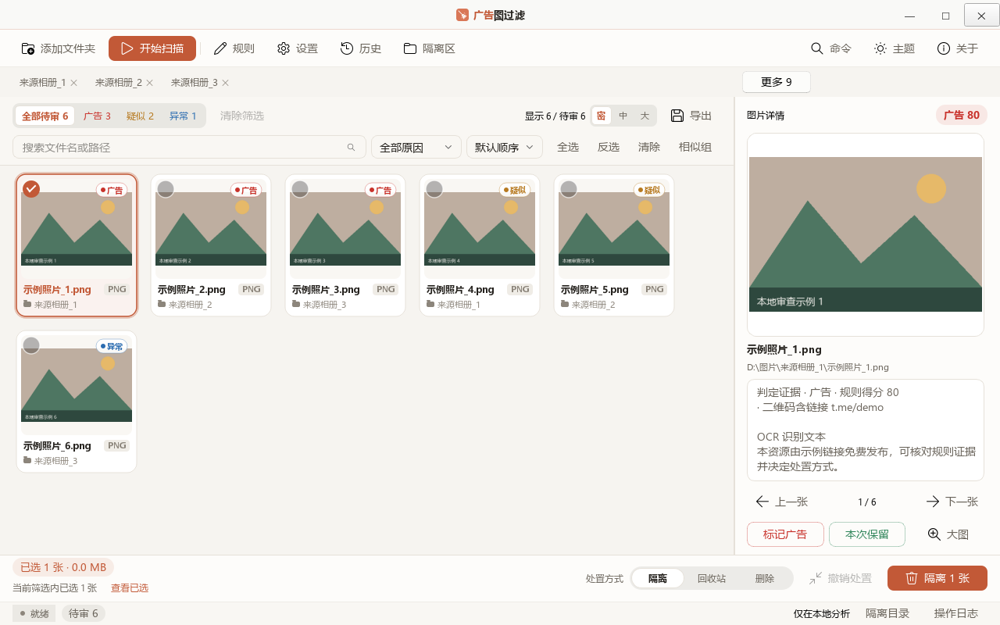

<div align="center">


# Ad Image Filter GUI

**A 100% local Windows review workbench for batch-screening promotional banners, watermarks, and QR-code spam in photo folders**

<p>
  <a href="https://github.com/ElmaTony/Ad-Image-Filter-GUI/releases/latest">
    
  </a>
  
  
  
  <a href="LICENSE">
    
  </a>
</p>

<p>
  <a href="README.md">简体中文</a> · <strong>English</strong>
</p>

<p>
  <a href="https://github.com/ElmaTony/Ad-Image-Filter-GUI/releases/latest">Download Latest</a> ·
  <a href="#highlights">Highlights</a> ·
  <a href="#quick-start">Quick Start</a> ·
  <a href="#themes--views">Themes &amp; Views</a> ·
  <a href="#detection-engine">Detection Engine</a> ·
  <a href="#developer-guide">Developer Guide</a>
</p>

<br />



</div>

---

## Highlights

<table>
  <tr>
    <td width="50%">
      <strong>🔍 4 Independent Local Channels</strong><br />
      Filename regex &amp; allowlist, aspect-ratio / resolution geometry checks, OpenCV + pyzbar QR decoding, and local RapidOCR text detection—each independently toggleable.
    </td>
    <td width="50%">
      <strong>🖼️ High-Density Review Workbench</strong><br />
      4 curated theme palettes with light/dark modes, 3 card grid densities, visual similarity clustering (<code>⟲N</code>), full-resolution Lightbox viewer, and a <code>Ctrl+K</code> Command Palette.
    </td>
  </tr>
  <tr>
    <td width="50%">
      <strong>🛡️ Safe, Reversible Disposal</strong><br />
      Quarantines files by default with one-click Undo, a Quarantine browser, and selective restore—plus optional Windows Recycle Bin and Permanent Delete modes.
    </td>
    <td width="50%">
      <strong>🔒 100% Local &amp; Offline Privacy</strong><br />
      Image decoding, OCR inference, and scan caching run strictly on your PC. Portable config and cache files stay next to the EXE; no images or folder metadata ever leave your device.
    </td>
  </tr>
</table>

---

## Quick Start

### Download & Run

For **Windows 10 / 11 (64-bit)**, single-file portable executable:

1. Download `AdImageFilter-Windows-x64.exe` from [GitHub Releases](https://github.com/ElmaTony/Ad-Image-Filter-GUI/releases/latest) (sign in with an authorized GitHub account while the repository is private).
2. Place the EXE in any permanent folder and double-click to run; configuration, cache, history, and logs are saved beside the executable.
3. To upgrade without losing settings, close the running app and replace the old EXE with the new one in the same folder.

> [!TIP]
> **In-App Update Check**: Open **About → Check for Updates** (in narrow windows: **More → About**) to copy the current version, open your local data folder, or check for new releases on demand. When a newer release is available, the dialog shows its version and download link so you stay in control of replacing the binary. Private-repo checks reuse Git Credential Manager or read `ADFILTER_GITHUB_TOKEN` (read-only **Contents** scope only; never written to disk).

### 4-Step Cleanup Workflow

| Step | Action | Details |
| :---: | --- | --- |
| **1** | **Add Folders** | Click **Add Folder** or drag-and-drop directories; recursively scans `JPG / JPEG / PNG / WebP / BMP / GIF` and automatically skips quarantine folders |
| **2** | **Scan & Filter** | Pause, resume, or cancel anytime; SQLite cache accelerates repeat scans; filter by verdict (All / Ad / Suspect / Error), hit reason, path search, and 5 sort modes |
| **3** | **Review & Select** | Inspect rule scores and full OCR text in the detail pane, or press `Enter` / double-click for Lightbox review; selections persist across filters with **View Selected** |
| **4** | **Dispose & Recover** | Choose **Quarantine** (default), **Recycle Bin**, or **Delete** with a pre-disposal summary including hidden selections; restore via one-click **Undo** or **Quarantine Manager** |

---

## Themes & Views

The unified theme engine supports full **Light / Dark** modes across every palette with smooth cross-fade transitions. Switch anytime from the filter bar, **Settings → Appearance & Theme**, or the `Ctrl+K` Command Palette.

| Palette | Accent | Aesthetic | Status |
| --- | :---: | --- | :---: |
| **Atelier 2.0** (`宣纸暖陶 2.0`) | `#C25937` | Warm paper surface with restrained terracotta accents—crisp hierarchy without yellow cast | Default |
| **Slate Gallery** (`石墨画廊`) | `#2563EB` | Cool neutral grayscale with cobalt blue accents for color-neutral photo inspection | Optional |
| **Sage Celadon** (`翠影青瓷`) | `#0F766E` | Soft mist gray / deep pine dark with sage-teal accents for low eye fatigue | Optional |
| **Obsidian Darkroom** (`极夜暗房`) | `#18181B` | High-contrast darkroom surfaces with sharp image/text boundaries | Optional |

**3 Card Grid Densities**: `Compact (密 · Default)` for rapid visual triage · `Standard (中)` balancing thumbnail size and hit summary · `Large (大)` for close inspection.

---

## Detection Engine

Toggle each detection channel independently in **Settings**. Works alongside **dHash Similarity Clustering** (`⟲N` badge with one-click group selection), an interactive **Rule Tester**, **JSON config import/export**, **CSV report export**, and **Scan History** (last 100 runs).

| Channel | How It Works | Default |
| --- | --- | :---: |
| **Filename & Allowlist** | Regex matching for channel names, promo terms, and `@handle` tags; allowlist rules take priority | Enabled |
| **Image Geometry** | Header-only dimension inspection flagging extreme aspect-ratio banners or tiny resolutions for review | Enabled |
| **QR Code** | Local OpenCV + pyzbar decoding; flags URLs and naked domains as Ad, while plain-text or structurally valid undecodable codes are marked Suspect with text previews | Enabled |
| **OCR Text** | Local RapidOCR inference; preserves high-res head/tail crops for tall vertical images, samples animated GIF/WebP frames, applies brightness boost for watermarks, and scores lines independently | Disabled |

<details>
<summary><strong>⌨️ Keyboard Shortcuts (Workbench &amp; Lightbox)</strong></summary>

<br />

| Context | Shortcut | Action |
| --- | --- | --- |
| Workbench | `Space` | Toggle selection on current image |
| Workbench | `Enter` | Open Lightbox viewer |
| Workbench | `Ctrl+A` | Toggle select all within active filter |
| Workbench | `Ctrl+K` | Toggle Command Palette |
| Workbench | `Delete` | Open disposal confirmation dialog |
| Lightbox | `←` / `→` | Previous / next image |
| Lightbox | Wheel / Drag / Double-click | Zoom, pan, reset view |
| Lightbox | `F` | Toggle clean view (hide floating toolbars) |
| Lightbox | `A` / `K` | Mark as Ad / Keep This Time |
| Lightbox | `Esc` | Close Lightbox |

</details>

<details>
<summary><strong>🔒 Local Data Files &amp; Network Scope</strong></summary>

<br />

- **Offline Image Analysis**: Decoding, QR scanning, OCR inference, and perceptual hashing run solely on your PC—never uploading images, OCR text, or folder paths.
- **Portable Data Files** (stored alongside the EXE or script):
  - `ad_filter_config.json`: rules, theme palette, grid density, and preferences
  - `ad_filter_cache.db`: local SQLite scan cache (retains per-configuration signatures with automatic pruning; switching themes, density, or scan modes keeps prior cache intact)
  - `ad_filter_history.json`: last 100 scan history entries
  - `ad_filter_log.jsonl`: operation and disposal logs
- **Minimal Network Usage**: Connects to GitHub only when you manually click **Check for Updates** to read release metadata; access tokens are never saved to disk.

</details>

---

## Developer Guide

Requires **Windows 10 / 11 (64-bit)** and **Python 3.10+**. See also [Feature Inventory](FEATURE_INVENTORY.md), [Release Notes](RELEASE_NOTES.md), [Testing Guide](tests/README.md), and [Project Conventions](AGENTS.md).

<details>
<summary><strong>🛠️ Running from Source &amp; CLI Commands</strong></summary>

<br />

```powershell
python -m venv .venv
.\.venv\Scripts\python.exe -m pip install -r requirements.txt
.\.venv\Scripts\python.exe ad_filter.py
```

| Command | Purpose |
| --- | --- |
| `.\.venv\Scripts\python.exe ad_filter.py --selftest` | Headless engine, cache, and quarantine self-test |
| `.\.venv\Scripts\python.exe ad_filter.py --gui-test` | Full GUI functional regression suite in isolated temp dirs |
| `.\.venv\Scripts\python.exe ad_filter.py --smoke` | GUI smoke test (auto-exits after 3 seconds; never touches user data) |
| `.\.venv\Scripts\python.exe ad_filter.py --bench` | Detection engine performance benchmark |
| `.\.venv\Scripts\python.exe ad_filter.py --make-fixtures` | Generate synthetic test samples in `testdata/` |

> For headless GUI test runs, set `$env:QT_QPA_PLATFORM = 'offscreen'` first.

</details>

<details>
<summary><strong>📦 Packaging Single-File EXE &amp; Publishing</strong></summary>

<br />

1. Bump [VERSION](VERSION) (`MAJOR.MINOR.PATCH`, no `v` prefix). The in-app **About** dialog, Windows EXE version metadata, GitHub tag (`vX.Y.Z`), and release title (`Ad Image Filter GUI vX.Y.Z`) are all derived from `VERSION`.
2. Update [RELEASE_NOTES.md](RELEASE_NOTES.md) with concise user-facing Chinese and English bullet points separated by `---` (no top-level heading or standalone date line).
3. Install build dependencies and package the single-file EXE (`广告图过滤.exe` in repo root; `build/`, `dist/`, and `.spec` are cleaned automatically):

```powershell
.\.venv\Scripts\python.exe -m pip install -r requirements-build.txt
powershell -ExecutionPolicy Bypass -File .\scripts\build.ps1
```

4. Verify the packaged binary, commit changes, and publish to GitHub Releases:

```powershell
.\scripts\publish.ps1 -NotesFile RELEASE_NOTES.md
```

</details>

<details>
<summary><strong>🗂️ Project Structure</strong></summary>

<br />

```text
ad-filter-gui/
├── ad_filter.py          # Scan engine, 4 detection channels, dHash grouping, SQLite cache, quarantine/undo & CLI
├── ad_filter_gui.py      # Main window controller, interactions, shortcuts, Command Palette & --gui-test
├── workbench_ui.py       # Review workbench layout, filter bar, CardDelegate & density switcher
├── dialog_ui.py          # Settings, Rule Tester, Quarantine, History, About & confirmation dialogs
├── cds_tokens.py         # Unified multi-palette theme engine & 3-tier density tokens
├── cds_widgets.py        # Theme-aware custom widgets (CommandPalette, Toast, Badge, Segmented, etc.)
├── cds_layouts.py        # Responsive flow layout helper
├── update_check.py       # GitHub Release metadata fetcher & version comparator
├── scripts/              # Build (build.ps1), publish (publish.ps1) & version helper scripts
├── tests/                # Unit tests, UI audit & end-to-end regression suite
├── assets/               # Application icon assets
└── docs/screenshots/     # Documentation screenshots
```

</details>

---

<div align="center">
  Released under the <a href="LICENSE">MIT License</a>
</div>
