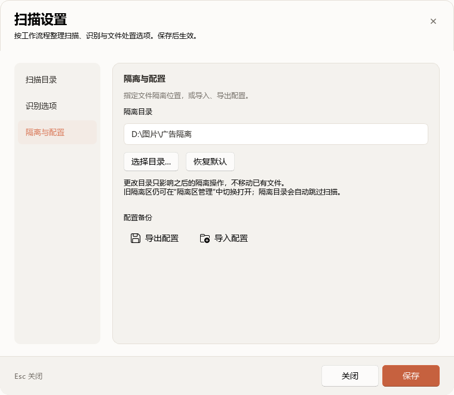

# 广告图过滤（Ad Image Filter GUI）

纯本地运行的图片广告过滤工具：扫描本地文件夹，用**多层信号**识别夹带推广信息/渠道引流的广告图，人工确认后批量处置（隔离可回滚 / 回收站 / 删除）。**所有分析都在本机完成，不上传任何数据。**

## 界面与交互

**暖陶工作台**：暖灰底色、陶土橙主色，深浅双主题。顶栏提供扫描、规则、设置、历史、隔离区与命令入口；图片墙采用分行筛选和可见的批量选择工具；右侧详情可拖动调宽；底部集中展示处置范围，状态和日志另行分层。


- “全部待审”包含广告、疑似、异常，三类可以独立筛选。
- 分类入口直接显示各类数量；“显示 N / 待审 M”区分当前筛选与全部待审。清除筛选保留勾选与排序。
- 筛选外的已选数量持续提示；“查看已选”可核对全部勾选，再次点击恢复原筛选。全选和反选只作用于当前显示，清除选择作用于全部勾选。
- 文件夹过多时通过“更多”查看完整路径、逐项进度和打开/移除操作；窄窗口提供更多菜单和两行处置栏，详情内容可滚动，单图动作保持可见。
- 底栏显示全局已选数量、大小和筛选外隐藏数量；三个可见处置选项对应明确的执行按钮文案。
- “标记广告”表示加入待处置；“本次保留”仅移出本次结果，不写白名单。
- 设置支持相似距离阈值，导入配置后同步全部控件；详情保留完整已保存的 OCR 文本。
- 规则、设置、历史、隔离区和确认窗口统一使用暖陶样式，提供关闭按钮与 `Esc` 关闭；历史支持按时间或目录搜索。
- 命令面板支持再次点击“命令”、`Esc` 或 `Ctrl+K` 关闭。
- 大图在独立图片区域内完整适配，顶部信息与底部操作不遮挡图片；`F` 切换纯净查看，`Esc` 退出。
- 图片按手机照片的方向信息显示；大图后台加载，放大时按需加载原始像素。

- 图片墙：缩略图卡片网格，单击看详情，空格/点圈勾选，`←` `→` 翻页，双击进画廊查看器（滚轮缩放 / 拖拽平移 / 双击 1.25×）
- 详情面板：大图预览（按面板尺寸自适应）、判定/分数/命中原因/OCR 文本、标记广告 / 保留
- 筛选与排序：判定 / 命中原因 / 路径搜索（防抖）/ 名称 / 大小 / 修改时间 / 分数
- 文件夹进度：每个导入文件夹实时显示 已扫/总数，完成打 ✓，并显示当前正在扫描的文件名；chip 可 ✕ 移除、右键打开目录
- 扫描控制：暂停 / 继续（真正停止提交新任务）/ 取消；处置中按钮禁用
- 操作日志：底部可折叠日志面板；扫描历史自动记录最近 100 次

## 识别能力（四种信号，可独立开关）

1. **文件名规则**——正则匹配（渠道号、推广词等，可自定义）
2. **形状规则**——极端横条 / 过小分辨率提示疑似（只读文件头，不直接判定广告）
3. **二维码**——**pyzbar 主解码**，OpenCV 补充解码。解出推广链接记为广告，解出普通文本或确认具有二维码结构但读不出内容时记为疑似。普通条码与仅有相似轮廓的图案不计作二维码。
4. **OCR 文字**——RapidOCR 本地模型；上下条带裁切 + 原图识别 + 提亮增强 + 全图兜底，按推广词库加权计分（≥6 广告，其余词库命中记疑似）

辅助能力：**dHash 相似聚类**（同一广告的多次转发归组，一键批量勾选）、**纯空白图跳过**（仅所有像素完全均匀时放行，少量文字和低对比度图片仍参与识别）。

## 处置与恢复

- 三种方式：**隔离**（移入 `_广告隔离/`，附 `manifest.json`，可回滚）/ **系统回收站** / **直接删除**（回收站与删除有二次确认）
- 处置前影响预览：分类计数 + 总大小
- **撤销处置**：上一次隔离可一键撤销，文件原路移回
- **隔离区管理**：条目化查看，还原选中 / 彻底删除选中 / 全部还原
- **自定义隔离目录**：设置 → 隔离与配置 → 选择目录 → 保存。留空恢复扫描盘默认位置；更改目录不会移动已有文件，隔离区管理可切换旧位置或打开其他隔离区。当前与历史隔离目录会自动跳过扫描。
- 同名文件自动避让，隔离清单异常时停止操作；移动前保存恢复记录，中断后可恢复；多个窗口操作同一隔离区时自动互斥。
- 新版隔离清单支持复制或移动整个隔离区后打开，操作仅作用于所选目录。旧版清单如引用目录外的文件，会停止操作并提示在原隔离目录打开。



## 规则与配置

| 类别 | 说明 |
|---|---|
| 文件名规则 | 匹配文件名的正则，命中直接判广告 |
| OCR 词库 | 匹配 OCR 文本的正则 + 权重，累计计分 |
| 白名单 | 匹配文件名的正则，命中直接放行 |

- **规则测试器**：贴一段 OCR 文本（可选文件名）即时试算得分与判定，改规则前先验证
- **配置导入导出**：规则词库与设置导出 JSON，另一台机器直接导入
- **结果导出**：当前筛选结果一键导出 CSV 报告

规则或识别方式变更后**缓存自动失效**（配置版本号机制），下次扫描全量重判，不用手动删缓存。

## 环境要求与安装

- Windows 10/11（macOS/Linux 理论可用，未测试）
- Python 3.10+

```bash
git clone https://github.com/ElmaTony/Ad-Image-Filter-GUI.git
cd ad-filter-gui
pip install -r requirements.txt
```

依赖：PySide6、PySide6-Fluent-Widgets、PySideSix-Frameless-Window、Pillow、OpenCV、**pyzbar**、RapidOCR、send2trash。Fluent 组件须使用 [PySide6 对应版本](https://qfluentwidgets.com/pages/install/)。

## 快速开始

```bash
python ad_filter.py                 # 启动 GUI
python ad_filter.py --selftest      # 引擎自测（无界面）
python ad_filter.py --make-fixtures # 生成合成测试样本到 testdata/
python ad_filter.py --bench         # 性能基准
python ad_filter.py --gui-test      # GUI 功能自测（131 项断言）
```

使用流程：添加文件夹（或拖入）→ 开始扫描 → 逐张确认或批量勾选 → 选处置方式 → 执行处置。需要回滚时用「撤销处置」或「恢复隔离区」。

快捷键：`空格` 勾选、`Enter` 大图、`Delete` 处置、`Ctrl+A` 全选/取消、`Ctrl+K` 命令面板；画廊内 `A` 标广告、`K` 保留、`←` `→` 翻页、`Esc` 关闭。

首次使用：OCR 模型加载约 2 秒，之后**共享单实例常驻内存**；没有真实样本也能用 `--make-fixtures` 生成合成图验证识别管线。

## 工作原理

```
文件收集（跳过隔离目录）
  ├─ 1. 文件名正则 → 直接判 ad
  ├─ 2. 只读图片头：极端横条记疑并继续找内容；最小边过小 → 疑似
  └─ 3. 需要像素时（前两级未命中）：
        ├─ 纯空白图 → 直接放行（跳过后续识别）
        ├─ pyzbar / OpenCV 解码：含引流内容 → ad；普通文本或未解码但结构校验通过 → 疑似
        └─ OCR：上/下条带拼接 → 原图识别 → 未达广告线则提亮重试
             → 未达广告高阈值且开了"全图兜底"：整图降到 1100px 再识别
             → 加权计分：≥6 广告；其余词库命中记疑似（词库可自定义）
```

- **逐级短路**：得分够广告线立即停止，不浪费推理
- **缓存**：判定按 路径+大小+mtime 存 SQLite，二次扫描秒开；配置版本变化自动全量重判
- **性能实测**：QR 通道约 10ms/张，OCR 共享单实例，线程上限 8
- **扫描提速**：完成一张即补充下个任务；相同小图的重复 OCR 复用结果，保留文字累积顺序与原判定规则。调整相似图阈值不再清空识别缓存。

## 测试（分层）

| 层级 | 命令 | 说明 |
|---|---|---|
| 引擎自测 | `python ad_filter.py --selftest` | 无需 GUI，合成 fixture |
| GUI 功能自测 | `python ad_filter.py --gui-test` | 131 项断言 |
| 工作台回归 | `python tests/test_workbench.py` | 28 个用例，包含工作台分类、跨筛选选择、文件夹溢出、窄屏、快捷键和文件操作 |
| 引擎回归 | `python tests/test_scan_engine.py` | 11 个用例，包含调度、取消、OCR 复用及隔离/恢复 |
| 审查修复回归 | `python tests/test_review_fixes.py` | 17 个用例，包含双进程隔离、恢复日志、稀疏文字、缓存、配置和原图加载 |
| 新旧版对照 | `python tests/benchmark_scan.py` | 与 Git 基线逐字段比较结果并计时，使用临时缓存 |
| UI 元素审查 | `python tests/audit_ui.py` | 100 项几何/颜色断言，深浅主题与三个窗口尺寸 |
| 端到端 | `python tests/test_e2e.py` | 37 项完整操作链 |
| 精度 | `python tests/test_accuracy.py` | 6 类广告 + 6 类干扰负样本，共 44 张合成图片 |

> GUI 测试可设 `QT_QPA_PLATFORM=offscreen` 在离屏平台运行，界面截图使用本机字体。`test_e2e.py` 需要 `testdata/real4_*`、`real6_*`，这些个人样本不随仓库分发；其余合成测试可在安装依赖后运行。文件处置测试已固定到专用临时隔离区。

## 项目结构

```
ad_filter.py          # 识别引擎 + CLI（--selftest/--gui-test/--bench/--make-fixtures）
ad_filter_gui.py      # GUI 主程序（图片墙/详情/处置/弹窗/测试）
workbench_ui.py       # 暖陶工作台视图和配套窗口主题
cds_tokens.py         # 设计令牌（色彩/尺寸/语义色体系）
cds_widgets.py        # 通用组件（Toast/命令面板/骨架屏等）
cds_layouts.py        # 主区布局管理（无侧栏，单形态）
build-exe.txt         # 打包脚本（自动复制到根目录并清理 dist/build/spec）
scripts/              # 可复用的打包、清理和 GitHub Release 发布脚本
tests/                # 测试套件（见上表）
assets/               # 主题图标资源
```

## 构建 exe

推荐使用项目虚拟环境和构建脚本：

```powershell
python -m venv .venv
.\.venv\Scripts\python.exe -m pip install -r requirements-build.txt
powershell -ExecutionPolicy Bypass -File .\scripts\build.ps1
```

产物为根目录 `广告图过滤.exe`。构建成功后自动清理 `dist/`、`build/`、`.spec` 和源码字节码缓存，保留用户数据与依赖环境。单文件首次运行会先解压依赖。

每次更新必须测试、打包、清理、推送源码并上传 GitHub Release，约定见 `AGENTS.md`。提交源码后，执行 `scripts/publish.ps1 -Tag <版本> -Title <标题> -NotesFile RELEASE_NOTES.md`；脚本复用 Git 凭据或 `GH_TOKEN`，将 EXE 上传到发行草稿，核对附件后再公开发布。

## 隐私声明

- 所有扫描、OCR、聚类均在本地完成，**无任何网络请求**
- 默认隔离目录位于首个导入文件夹所在盘根目录的 `_广告隔离/`，确认时显示实际位置；`manifest.json` 记录原始路径用于恢复
- 操作日志仅写在本地 `ad_filter_log.jsonl`
- `testdata/` 中的真实样本、缓存、配置、历史、日志均不进入仓库；EXE 仅作为发行版附件上传

## License

MIT
