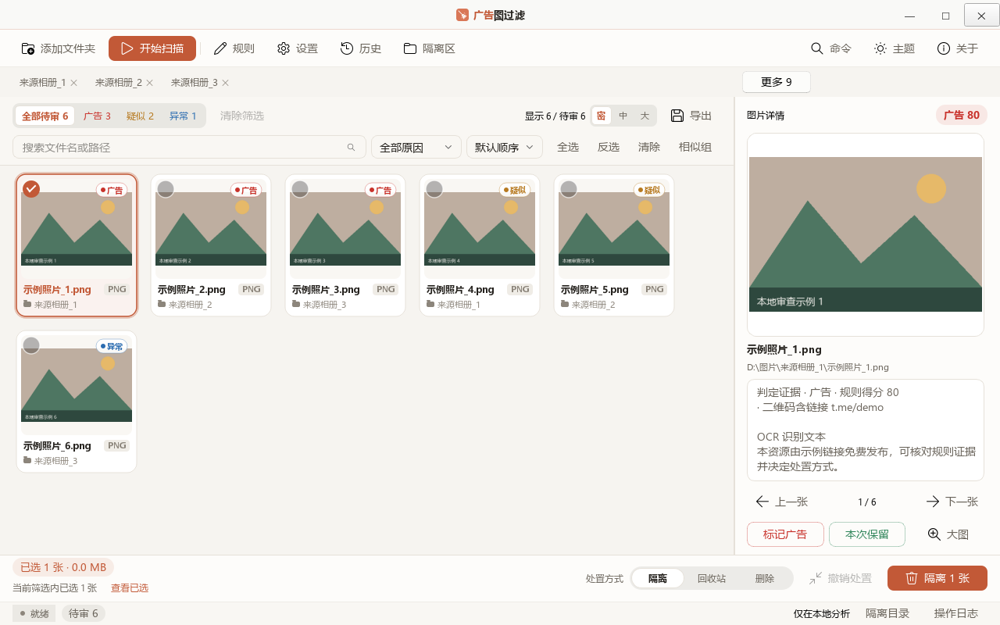
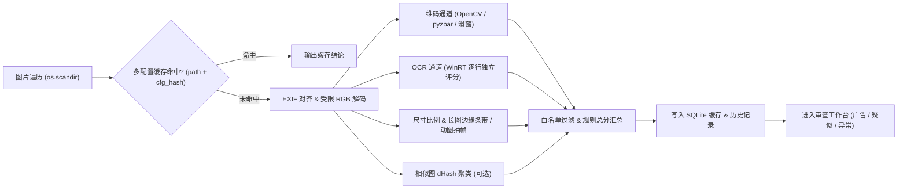

<div align="center">


# 广告图过滤 · Ad Image Filter GUI

**完全离线的 Windows 本地相册广告图与引流图筛查工作台**

[](https://github.com/ElmaTony/Ad-Image-Filter-GUI/releases/latest)
[](https://github.com/ElmaTony/Ad-Image-Filter-GUI/releases)
[](requirements.txt)
[](https://github.com/ElmaTony/Ad-Image-Filter-GUI)

**简体中文** · [English](README.en.md)

[核心亮点](#核心亮点) · [识别与判定机制](#识别与判定机制) · [快速上手](#快速上手) · [工作台与快捷键](#工作台与快捷键) · [隐私与本地数据](#隐私与本地数据) · [开发与构建指南](#开发与构建指南)

<br>

<picture>
  <source media="(prefers-color-scheme: dark)" srcset="docs/screenshots/workbench-dark.png">
  <source media="(prefers-color-scheme: light)" srcset="docs/screenshots/workbench-light.png">
  
</picture>

</div>

---

下载打包资源或批量整理图片目录时，文件夹里常常混入大量二维码推广图、免费分享引流横幅、长图页眉页脚水印以及低清装饰图标。**广告图过滤**将**本地多通道识别引擎**与**双栏审查工作台**结合在一起：所有识别都在本机离线完成，每张命中图片都会列出清晰的得分与证据摘要，先审后处，支持一键隔离并随时撤销。

## 核心亮点

- **全离线多通道判定**：融合二维码解码、Windows 本地 WinRT OCR、长图头尾边缘条带采样、动图抽帧、尺寸比例检测与相似图 dHash 聚类，无需任何云端 API 或 GPU。
- **证据可解释、先审后处**：在工作台右侧实时查看命中原因、规则总分、二维码/链接详情与 OCR 原文摘录，支持按结论（广告 / 疑似 / 异常）与具体原因快速过滤。
- **安全可逆的处置链路**：默认采用「隔离」而非直接删除，跨盘安全迁移至目标盘根目录 `_广告隔离`，写入清单与前置操作日志，并支持一键撤销最近一次隔离或打开隔离区批量恢复。
- **面向大相册的性能与内存优化**：采用 `os.scandir` 快速枚举文件、大图低内存受限解码与 EXIF 方向对齐；SQLite 缓存按 `(文件路径, 配置哈希)` 隔离，调整规则后自动重算并清理过期记录。
- **现代 Fluent 双栏工作台**：基于 PySide6 与 QFluentWidgets 构建，支持深浅主题切换、4 套设计色板（`atelier`、`slate`、`sage`、`obsidian`）、3 档卡片密度、命令面板（`Ctrl+K`）以及 Lightbox 全屏大图审阅。

## 识别与判定机制

扫描引擎在 `ad_filter.py` 中对每张图片按预设与自定义规则并行评分，再与白名单和阈值核对，最终输出「广告」「疑似」「正常」或「异常」结论：



| 识别通道 | 覆盖场景与能力说明 | 关键策略 |
| --- | --- | --- |
| **二维码识别** | 识别画面中的推广二维码、导流链接与小程序码 | 结合 OpenCV、pyzbar 与多尺度滑窗 ROI；支持提取含链接与裸域名二维码细节，区分有效引流与纯文本码 |
| **本地文字 OCR** | 识别中文、英文、日文推广文案与引流口令 | 调用 Windows 原生 WinRT OCR；按单行独立匹配关键词与正则权重，防止跨行误拼接；长图自动补采头尾边缘条带 |
| **动图与尺寸规则** | 捕获 GIF / WebP 动图夹带广告及极端尺寸贴片 | 动图多帧采样检测；支持小图标、极端长宽比横幅/竖幅与超长拼接图权重规则 |
| **相似图聚类（可选）** | 收拢批量下载中重复出现的多份同款推广图 | 基于 dHash 计算感知距离并标记相似组（`⟲N`），方便一键整组勾选复核 |
| **白名单放行** | 保护特定命名规则或目录中的正常素材 | 命中白名单关键词或正则时直接抑制广告加分，降低特定图集误报 |

## 快速上手

### 方式一：直接下载便携版 EXE（推荐）

前往 [GitHub Releases](https://github.com/ElmaTony/Ad-Image-Filter-GUI/releases/latest) 下载最新的 **`广告图过滤.exe`**，放到任意可写目录后双击即可运行，无需安装 Python 或额外运行库。

> [!TIP]
> **离线与按需检查更新**：软件启动和扫描全程不连网。仅当你在「关于」窗口主动点击检查更新时，才会向 GitHub Release API 请求版本号与发行说明摘要（私有环境或限流时可通过环境变量 `ADFILTER_GITHUB_TOKEN` 或系统 Git 凭据辅助访问）。

### 方式二：从源码运行（Windows 10 / 11 + Python 3.10+）

```powershell
git clone https://github.com/ElmaTony/Ad-Image-Filter-GUI.git
cd Ad-Image-Filter-GUI
python -m venv .venv
.\.venv\Scripts\Activate.ps1
pip install -r requirements.txt
python ad_filter_gui.py
```

### 四步完成一次批量清理

| 步骤 | 在工作台中的操作 | 说明 |
| --- | --- | --- |
| **1. 添加目录** | 点击左上角「添加文件夹」或直接拖拽文件夹到窗口 | 支持多目录同时纳入审查；顶部文件夹标签栏支持单项移除或折叠收纳 |
| **2. 开始扫描** | 点击「开始扫描」 | 实时展示扫描进度与阶段状态；已有缓存的文件在配置未变更时直接秒出结果 |
| **3. 复核证据** | 切换「全部待审 / 广告 / 疑似 / 异常」与原因下拉框 | 右侧栏展示预览图、规则得分、具体命中项与 OCR 文本；可双击或点击「大图」进入 Lightbox 核验 |
| **4. 安全处置** | 确认勾选列表后选择「隔离 / 回收站 / 删除」并执行 | 推荐优先使用「隔离」；如发现误判，可在底部栏点击「撤销处置」或前往「隔离区」恢复 |

## 工作台与快捷键

### 主题色板、密度与全局命令

- **外观与主题**：通过顶部「主题」按钮即时切换浅色 / 深色模式，在「设置」中可选 **`atelier`**（暖陶土）、**`slate`**（冷石板）、**`sage`**（鼠尾草）、**`obsidian`**（黑曜石）四套色板。
- **卡片密度**：筛查栏支持一键切换 **`密`**（`compact`）、**`中`**（`standard`）、**`大`**（`large`）三种网格尺度，适配不同分辨率显示器。
- **规则与跨机配置**：在「规则」编辑器中可增删关键词、正则表达式、白名单和各维度阈值，并支持将规则配置导出 / 导入 JSON，方便在多台电脑之间同步规则体系。

### 常用快捷键

| 快捷键 | 适用界面 | 功能说明 |
| --- | --- | --- |
| `Ctrl+K` | 主工作台 | 打开命令面板（`CDSCommandPalette`），快速跳转设置、规则、切换主题、导出或启动扫描 |
| `Space` | 主工作台 / 大图 | 勾选或取消勾选当前选中的图片 |
| `←` / `→` / `↑` / `↓` | 主工作台 | 在审查网格卡片间移动焦点并同步刷新右侧详情 |
| `Enter` / `Double Click` | 主工作台 | 打开当前选中图片的 Lightbox 全屏大图预览 |
| `A` / `D` | 主工作台 / 大图 | 快速将当前图片标记为「广告」或「本次保留」 |
| `Ctrl+Z` | 主工作台 | 撤销最近一次「隔离」批量处置 |
| `←` / `→` / `Esc` | Lightbox 大图 | 切换上一张 / 下一张图片，或退出全屏预览 |
| `鼠标滚轮` / `拖拽` | Lightbox 大图 | 自由缩放与平移查看图片细节与角落小二维码 |

## 隐私与本地数据

- **零图片上传**：所有图像解码、二维码识别、WinRT OCR 与相似度哈希全部在本地内存和磁盘完成，不向外部服务器上传任何图片内容或文件路径。
- **便携式数据落盘**：应用默认在当前工作目录（或便携版可执行文件同级目录）读写以下 4 个本地文件，**不会被包含在 Git 仓库版本控制中**：
  - `ad_filter_config.json`：主题、色板、密度、扫描性能与自定义规则配置
  - `ad_filter_cache.db`：SQLite 扫描缓存数据库，按 `(path, cfg_hash)` 存储判定结果，支持自动清理陈旧条目
  - `ad_filter_history.json`：历史扫描摘要与目录统计记录
  - `ad_filter_log.jsonl`：处置操作前置日志（JSON Lines）
- **可追溯隔离区**：选择「隔离」时，文件会连同原始目录结构元数据与清单（manifest）写入目标磁盘根目录的 `_广告隔离`，并在写入前加锁与记录日志，确保断电或并发操作下仍具备恢复依据。

## 开发与构建指南

### 常用测试与验证命令

```powershell
# 1. 引擎自检与冒烟验证
python ad_filter.py --selftest
python ad_filter.py --smoke

# 2. 完整单元测试套件
python -m unittest discover -s tests -p "test_*.py" -v

# 3. 无头 GUI 功能、UI 像素审计与识别准确率基准测试
python ad_filter.py --gui-test
python tests/audit_ui.py
python tests/test_accuracy.py
python tests/test_e2e.py
python tests/benchmark_scan.py
```

引擎内置参数说明（`ad_filter.py`）：`--selftest`（单元测试自检）、`--gui-test`（GUI 烟雾与交互测试）、`--smoke`（扫描管线冒烟测试）、`--bench`（扫描性能基准）、`--make-fixtures`（生成临时合成测试图集）。测试与预览详情可参阅 [tests/README.md](tests/README.md)。

### 打包 Windows 单文件 EXE

安装打包依赖并执行内置构建脚本（版本号统一由根目录 [VERSION](VERSION) 驱动）：

```powershell
pip install -r requirements-build.txt
.\scripts\build.ps1
```

脚本会通过 PyInstaller 生成单文件可执行程序 `广告图过滤.exe` 到项目根目录，并自动注入版本信息与 `assets/icon.ico` 图标。版本管理与发布脚本位于 `scripts/version.ps1` 与 `scripts/publish.ps1`。

### 仓库核心结构

```text
ad-filter-gui/
├── ad_filter.py           # 扫描引擎：4 通道识别、白名单、边缘/动图采样、SQLite 多配置缓存、隔离与日志
├── ad_filter_gui.py       # 主应用控制器：缩略图加载、网格列表、LightBox 大图、规则/设置/历史/隔离弹窗
├── workbench_ui.py        # 工作台主结构与响应式适配：分类筛选、密度切换、双栏布局与字体配置
├── dialog_ui.py           # 弹窗体系与主题刷新：WorkbenchDialog、AboutDialog、NoticeDialog
├── cds_tokens.py          # 设计系统 Token：4 套色板 × 深浅双主题颜色与 3 档卡片密度规格
├── cds_widgets.py         # 通用组件：空状态视图、Toast 提示、Ctrl+K 命令面板
├── cds_layouts.py         # 固定工作台布局管理器（LayoutManager）
├── icon_embed.py          # 内嵌 Base64 应用图标资源
├── update_check.py        # GitHub Release 按需检查更新模块
├── assets/                # 应用图标资源（icon.png / icon.ico）
├── scripts/               # 版本、PyInstaller 打包与 GitHub 发布脚本（build.ps1 / publish.ps1 / version.ps1）
├── tests/                 # 单元测试、准确率基准、端到端与 UI 审查脚本
├── docs/                  # 预览截图、工作台规范与各阶段审查/基准报告
├── VERSION                # 当前语义化版本号（如 1.6.0）
├── FEATURE_INVENTORY.md   # 功能清单与模块职责对照
├── RELEASE_NOTES.md       # 面向用户的版本发行说明
└── AGENTS.md              # 项目构建、测试隔离与交付规范
```

---

<div align="center">

基于 **MIT License** 开源发布 · 欢迎通过 [Issues](https://github.com/ElmaTony/Ad-Image-Filter-GUI/issues) 反馈误判样本或优化建议

</div>
